# Project Documentation

**Digital Content Licensing, Royalty Tracking & Revenue Distribution Platform**
DBMS Experiential Learning, Level 3 Project. Option 1: SQL (MySQL) + NoSQL (MongoDB).

---

## Team

| Member | SRN | Responsibilities |
|--------|-----|------------------|
| Sphoorthi Pulipati | PES2UG24CS514 | **Application:** creator management page (`app/(app)/creators/page.tsx`, `app/api/creators/route.ts`) and platform management page (`app/(app)/platforms/page.tsx`, `app/api/platforms/route.ts`), both admin-only, with menu links in `components/nav.tsx`. **Database:** extra SQL test cases in `scripts/run-sql-tests.mjs` covering creator e-mail uniqueness and validation and the foreign key that protects licensed works. **Documentation:** application screenshots and testing results. |
| Sriya Yashita Chandu | PES2UG24CS523 | Database design and SQL objects (schema, views, stored routines, triggers, seed data), MongoDB usage ingestion, authentication and roles, and the dashboard, content, licences, usage, royalties and payments pages. |

Individual commits are visible in the Git history of this repository.

---

## 1. Objectives

- Record which creators own which works, and in what percentage.
- Record licences that grant a platform the right to use a work in certain territories for a period and at a royalty rate.
- Ingest usage reports from platforms. Platforms send them in their own formats.
- Calculate each creator's royalty from every usage record, correctly and only once.
- Pay creators their unpaid royalties and track the payment status.
- Enforce all business rules inside the database so data stays consistent.

## 2. Functional requirements

| # | Requirement | Role |
|---|-------------|------|
| F1 | Log in with e-mail and password; access depends on role | All |
| F2 | View, search (full-text) and filter the content catalogue | All |
| F3 | Add a work together with its ownership splits (max 100%) | Admin |
| F4 | Create licences with territories; change licence status | Admin |
| F5 | Submit a usage report; invalid lines are rejected with a reason | Admin |
| F6 | Calculate royalties for a period | Admin |
| F7 | Create a payout for a creator; update payment status | Admin |
| F8 | View own earnings, works, licences, royalty lines and payments | Creator |
| F9 | Dashboard with totals, revenue per platform and creator earnings | All |
| F10 | List, add and edit creators; duplicate or malformed e-mails are rejected by the database | Admin |
| F11 | List, add and edit platforms; duplicate names and malformed contact e-mails are rejected by the database | Admin |

## 3. ER diagram

See [ER_Diagram.pdf](ER_Diagram.pdf).

Entities: PLATFORM, CREATOR, CONTENT, LICENSE, USAGE_RECORD, ROYALTY, PAYMENT.
Relationships: OWNS (creator–content, M:N, with attributes ownership_percentage and role), GRANTED_TO (license–platform), COVERED_BY (license–content), GENERATES (license–usage), PRODUCED (usage–royalty), EARNS (creator–royalty), RECEIVES (creator–payment), SETTLES (payment–royalty).

## 4. Relational schema

See [Relational_Schema.pdf](Relational_Schema.pdf) and [DDL.pdf](DDL.pdf).

```
platform(platform_id PK, platform_name UQ, platform_type, country, contact_email, created_at)
creator(creator_id PK, name, creator_type, email UQ, phone, country, payout_currency,
        bank_account_enc, bank_account_last4, tax_id_enc, created_at)
content(content_id PK, title, content_type, genre, release_date, duration_sec, language, synopsis, created_at)
ownership(creator_id PK FK→creator, content_id PK FK→content, ownership_percentage, role)
license(license_id PK, platform_id FK→platform, content_id FK→content, license_type,
        start_date, end_date, royalty_rate, currency, status, created_at)
license_territory(license_id PK FK→license, territory PK)
usage_record(usage_id PK, license_id FK→license, usage_date, usage_type, quantity,
             gross_revenue, currency, source_batch_ref, ingested_at)
             UQ(license_id, usage_date, usage_type, source_batch_ref)
payment(payment_id PK, creator_id FK→creator, payment_date, amount, currency, method, status, transaction_ref UQ)
royalty(royalty_id PK, usage_id FK→usage_record, creator_id FK→creator, payment_id FK→payment,
        calculated_amount, currency, rate_applied, ownership_percentage_applied,
        calculation_date, period_start, period_end)   UQ(usage_id, creator_id)
app_user(user_id PK, email UQ, password_hash, role, creator_id FK→creator)
```

Normalisation: the multivalued attribute *territory* is moved into `license_territory` (1NF). The M:N OWNS relationship becomes `ownership`. Every non-key attribute depends on the whole key (3NF).

## 5. Database choice and justification

| Data | Database | Why |
|------|----------|-----|
| Creators, works, ownership, licences, usage, royalties, payments | **MySQL** | This is money and rights data with strict relationships. It needs foreign keys, CHECK constraints, triggers and ACID transactions so that a royalty is never calculated twice, a split never exceeds 100% and a payment never pays the same line twice. |
| Raw usage reports from platforms | **MongoDB** | Every platform sends different fields. A streaming service sends `subscriber_type` and `avg_listen_sec`, a video site sends `watch_time_minutes` and a `device` split, and a radio station sends `slot` and `city`. A document store keeps each report exactly as received with no fixed schema. Only the common fields (licence, date, quantity, revenue) are normalised into MySQL. Territory-level detail stays in MongoDB and is analysed with aggregation pipelines. |

## 6. Data dictionary (MySQL)

| Table | Column | Type | Constraint / meaning |
|-------|--------|------|----------------------|
| platform | platform_id | INT AI | PK |
| | platform_name | VARCHAR(120) | NOT NULL, UNIQUE |
| | platform_type | ENUM | STREAMING, SOCIAL, DOWNLOAD, BROADCAST, OTHER |
| | country | CHAR(2) | ISO 3166-1 |
| | contact_email | VARCHAR(254) | CHECK e-mail pattern |
| creator | creator_id | INT AI | PK |
| | name | VARCHAR(150) | NOT NULL |
| | creator_type | ENUM | INDIVIDUAL, BAND, LABEL, STUDIO, ESTATE |
| | email | VARCHAR(254) | UNIQUE, CHECK e-mail pattern |
| | payout_currency | CHAR(3) | default INR |
| | bank_account_enc, tax_id_enc | VARBINARY(512) | encrypted at application layer |
| content | content_id | INT AI | PK |
| | title | VARCHAR(255) | NOT NULL |
| | content_type | ENUM | AUDIO, VIDEO, IMAGE, TEXT, PODCAST |
| | duration_sec | INT | CHECK > 0 |
| | synopsis | TEXT | added by ALTER; FULLTEXT index with title, genre |
| ownership | (creator_id, content_id) | INT, INT | composite PK; FK creator RESTRICT, FK content CASCADE |
| | ownership_percentage | DECIMAL(5,2) | CHECK 0 < x ≤ 100; trigger: sum per work ≤ 100 |
| | role | ENUM | PRIMARY_ARTIST … DIRECTOR |
| license | license_id | INT AI | PK |
| | platform_id, content_id | INT | FK, ON DELETE RESTRICT |
| | license_type | ENUM | EXCLUSIVE, NON_EXCLUSIVE, SUBLICENSABLE |
| | start_date / end_date | DATE | CHECK end > start; NULL end = perpetual |
| | royalty_rate | DECIMAL(6,4) | CHECK 0–1 |
| | status | ENUM | DRAFT, ACTIVE, SUSPENDED, EXPIRED, TERMINATED; indexed |
| license_territory | (license_id, territory) | | composite PK; CHECK 2-letter code |
| usage_record | usage_id | INT AI | PK |
| | license_id | INT | FK; trigger: inside licence period and in licence currency |
| | quantity | BIGINT | CHECK > 0 |
| | gross_revenue | DECIMAL(14,2) | CHECK ≥ 0 |
| | source_batch_ref | VARCHAR(100) | MongoDB report `_id` |
| payment | payment_id | INT AI | PK |
| | amount | DECIMAL(14,2) | CHECK > 0 |
| | status | ENUM | PENDING, PROCESSING, COMPLETED, FAILED, REVERSED |
| | transaction_ref | VARCHAR(100) | UNIQUE |
| royalty | royalty_id | INT AI | PK |
| | usage_id, creator_id | INT | FK; UNIQUE pair (one line per creator per usage) |
| | payment_id | INT | FK, ON DELETE SET NULL; NULL = unpaid |
| | rate_applied, ownership_percentage_applied | DECIMAL | snapshot at calculation time |
| app_user | user_id | INT AI | PK |
| | email | VARCHAR(254) | UNIQUE |
| | password_hash | VARCHAR(100) | bcrypt |
| | role | ENUM | ADMIN, CREATOR; CHECK creator_id set only for CREATOR |

## 7. Implementation

### 7.1 SQL (MySQL), files in `database/mysql/`

- **DDL**: `DROP TABLE`, `CREATE TABLE` with PK, FK (CASCADE / RESTRICT / SET NULL), UNIQUE, CHECK and DEFAULT. `ALTER TABLE` adds `content.synopsis` and a CHECK on territory. `CREATE INDEX` and a `FULLTEXT` index.
- **Views**: `v_license_overview` (licence + names + territories), `v_creator_earnings` (earned / paid / unpaid per creator), `v_platform_monthly_revenue`.
- **Stored function**: `fn_creator_unpaid_balance(creator, currency)`.
- **Stored procedures (with transactions)**:
  - `sp_calculate_royalties(start, end, OUT lines)` inserts one royalty line per owner for every usage record not yet calculated, inside `START TRANSACTION … COMMIT`, and rolls back on error. It is idempotent because of `NOT EXISTS` plus `UNIQUE(usage_id, creator_id)`.
  - `sp_settle_creator_payout(creator, currency, method, OUT payment_id)` locks the unpaid lines with `SELECT … FOR UPDATE`, creates the payment and attaches the lines.
- **Triggers**:
  - `trg_ownership_bi` rejects ownership splits whose total exceeds 100%.
  - `trg_usage_bi` only accepts usage inside an ACTIVE or EXPIRED licence's period, in the licence currency.
  - `trg_payment_au` releases a FAILED or REVERSED payment's royalty lines back to unpaid.
- **Application transactions**: creating a work with its ownership rows, creating a licence with its territories, and loading a usage report (one transaction with a `SAVEPOINT` per row, so a rejected row does not undo the others).

Advanced SQL concepts used: transactions, views, stored procedures and functions, triggers, indexing, full-text search.

### 7.2 NoSQL (MongoDB)

**Database** `royalty_nosql`, **collection** `usage_reports`

```json
{
  "_id": "ObjectId  (also stored in MySQL usage_record.source_batch_ref)",
  "platform_id": 1,
  "platform_name": "Melodia Stream",
  "currency": "INR",
  "submitted_at": "ISODate",
  "status": "PROCESSED | PARTIAL | REJECTED",
  "lines": [
    { "license_id": 1, "usage_date": "2026-10-15", "territory": "IN", "quantity": 18250,
      "gross_revenue": 5840, "subscriber_type": "PREMIUM", "accepted": true }
  ],
  "errors": [ { "line": 3, "error": "Licence 8 does not belong to Melodia Stream" } ],
  "sql_usage_ids": [128, 129]
}
```

- **Validation**: a `$jsonSchema` validator makes `platform_id`, `currency`, `submitted_at`, `status` and `lines` required, restricts the values of `status`, and requires `currency` to be a 3-letter code. Line fields are free-form.
- **Indexes**: `{platform_id: 1, submitted_at: -1}` for listing a platform's latest reports, and a multikey index on `{"lines.territory": 1}`.
- **Aggregations** (shown on the Usage reports page):
  - Usage by territory: `$match` → `$unwind lines` → `$match accepted` → `$group by territory, currency` → `$sort`
  - Reports per platform: `$group` with `$sum`, `$size`

### 7.3 How the two databases work together (usage ingestion)

1. The admin submits a report (a JSON list of lines).
2. Each line is checked: the licence belongs to the platform, the territory is covered by the licence, the date is valid and not in the future, and the quantity and revenue are valid.
3. Valid lines are summed per (licence, date) and inserted into MySQL `usage_record` in one transaction. Trigger `trg_usage_bi` validates each row again.
4. The raw report, the per-line errors and the new MySQL ids are saved in MongoDB.

## 8. Important queries

All are in [`database/mysql/06_queries.sql`](../database/mysql/06_queries.sql):

| Query | Concepts |
|-------|----------|
| Q1 Royalty lines with creator, work, platform | 6-table JOIN, ORDER BY |
| Q2 Platforms with INR revenue > 1,00,000 | GROUP BY, HAVING, SUM, COUNT, AVG |
| Q3 Creators earning above average | subquery |
| Q4 Each work's best month | correlated subquery, MAX |
| Q5 Works with no licence | NOT EXISTS |
| Q6 Works with unallocated rights | LEFT JOIN, GROUP BY, HAVING |
| Q7 Content search | FULLTEXT MATCH … AGAINST |
| Q8 Unpaid balances | view + stored function |
| DML | INSERT, UPDATE, DELETE (cascade) in a rolled-back transaction |

## 9. System architecture

```
Browser (Next.js React pages)
        │ fetch JSON
        ▼
Next.js Route Handlers  /app/api/*   ── auth: bcrypt + JWT cookie, role check
        │                         │
        │ mysql2 (pool)            │ mongodb driver
        ▼                         ▼
   MySQL 8  royalty_db        MongoDB  royalty_nosql
   tables, views, triggers,    usage_reports (raw reports,
   procedures, function        aggregation pipelines)
```

Configuration (hosts, users, passwords, JWT secret) comes from environment variables in `.env.local`. Nothing is hard-coded.

## 10. Application screenshots

### 10.1 Login and admin dashboard

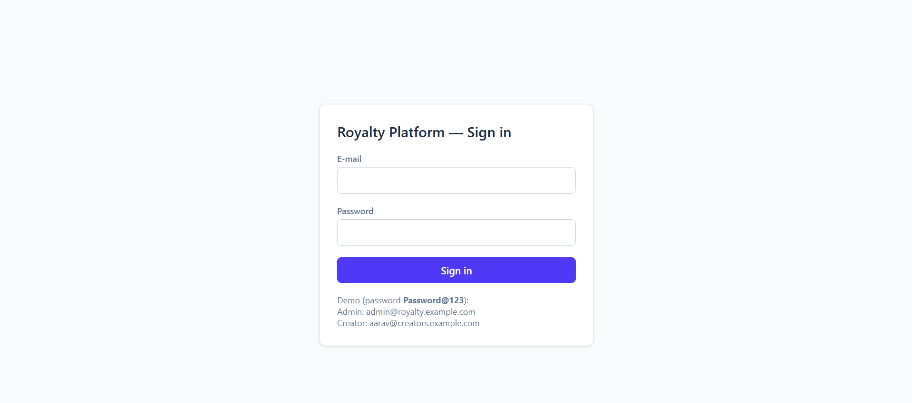

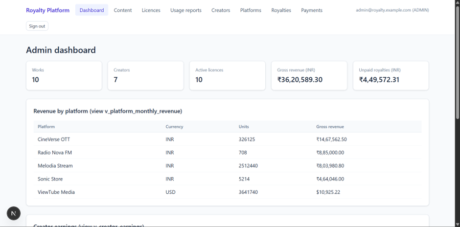

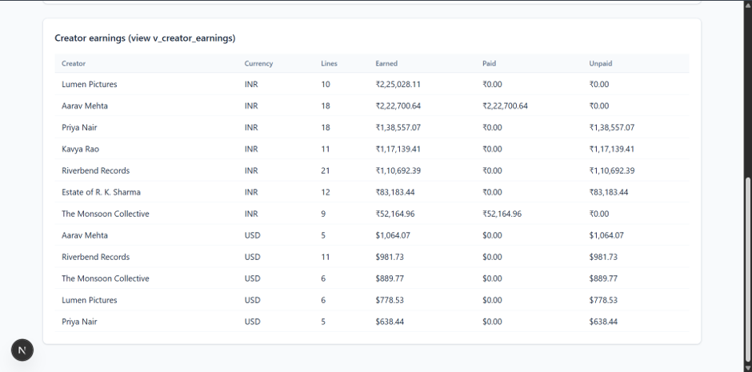

### 10.2 Creator management (admin only)

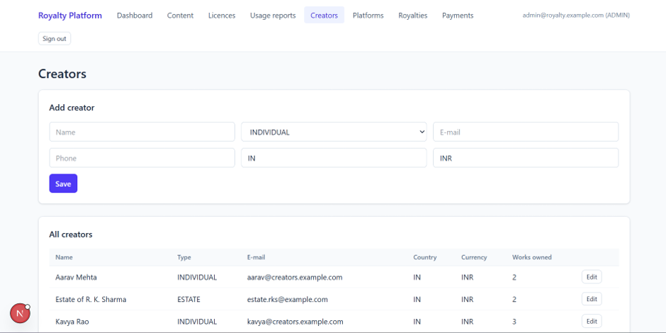

The admin can list, add and edit creators. Before this page, creators existed only as seed data. Input is validated by the database: a duplicate e-mail is rejected by the `UNIQUE` constraint `uq_creator_email`, and a malformed e-mail by the `CHECK` constraint `ck_creator_email`.

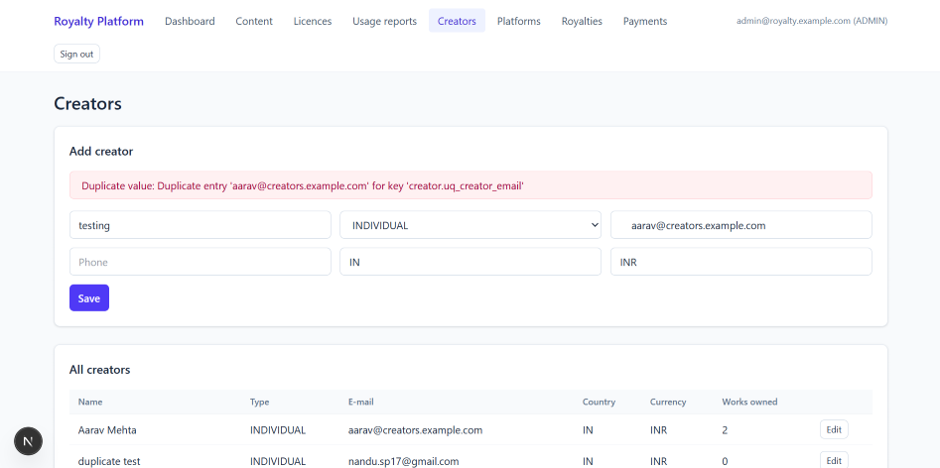

### 10.3 Platform management (admin only)

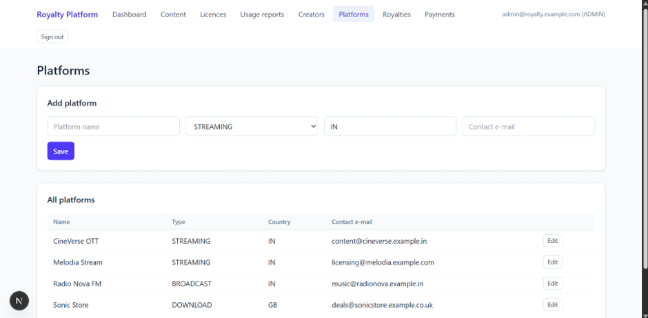

The admin can list, add and edit distribution platforms. Platform names are unique (`uq_platform_name`) and contact e-mails are validated by `ck_platform_email`.

### 10.4 Content, licences, usage reports, royalties and payments

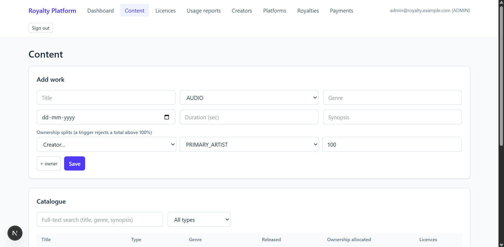

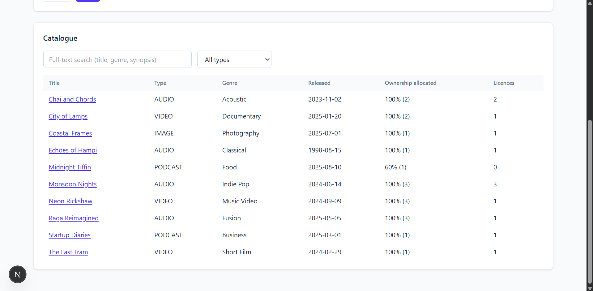

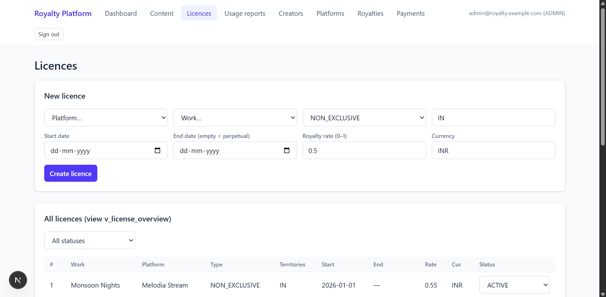

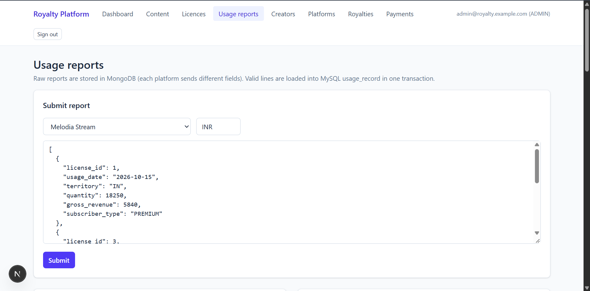

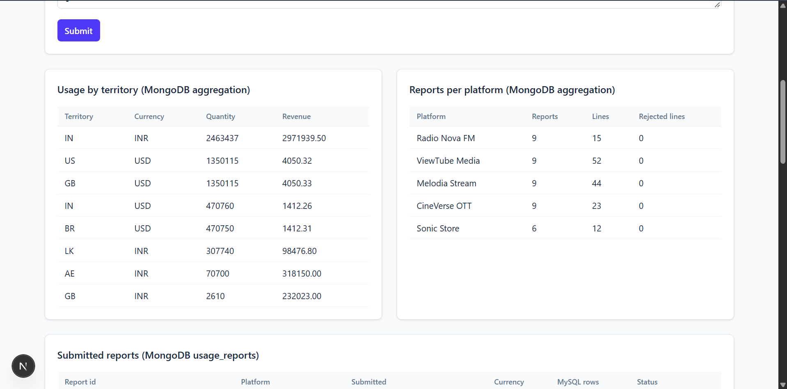

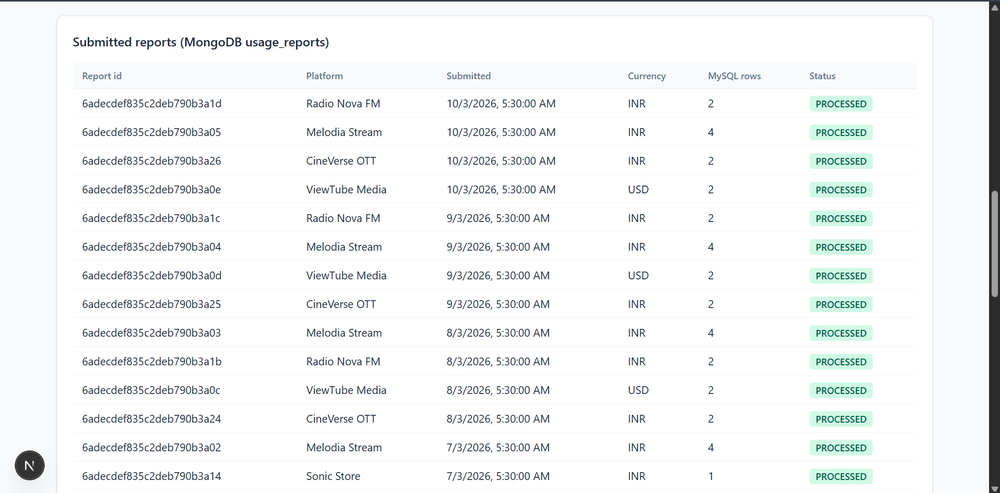

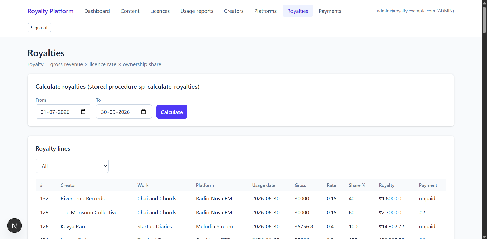

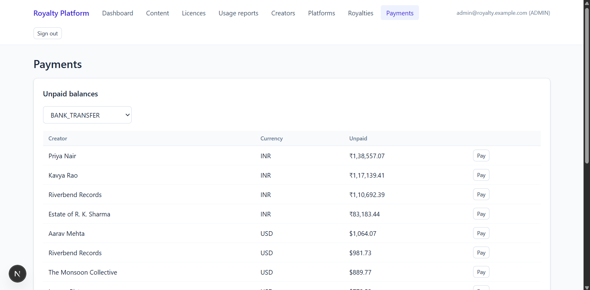

### 10.5 Creator view

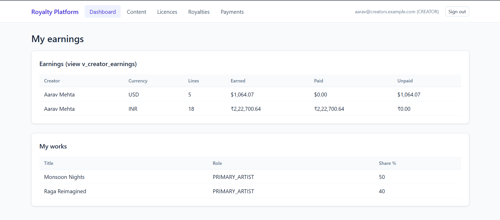

A creator who logs in sees only their own earnings, works, licences, royalty lines and payments.

### 10.6 Database test results

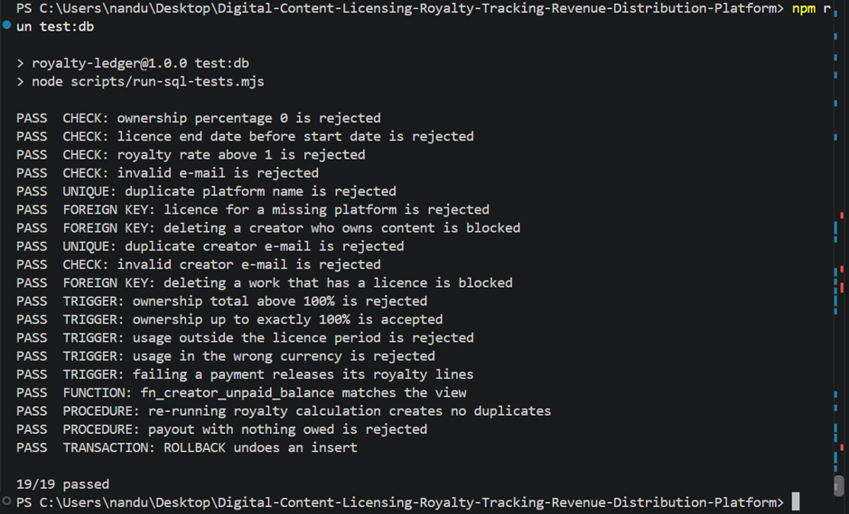

## 11. Testing results

`npm run test:db` runs 19 database test cases covering CHECK, UNIQUE, FK, triggers, function, procedures and transactions. All 19 pass. Full results: [TEST_RESULTS.md](TEST_RESULTS.md).

Tested through the application:

| Test | Expected | Result |
|------|----------|--------|
| Open /dashboard without logging in | redirect to /login | Pass |
| Wrong password | "Invalid e-mail or password" | Pass |
| Creator opens usage-report API | 403 "Not allowed for your role" | Pass |
| Creator views royalties | only their own lines | Pass |
| Add work with splits 70% + 40% | rejected by trigger | Pass |
| Licence with end date before start | rejected by CHECK ck_lic_dates | Pass |
| Usage report with a licence of another platform | line rejected, others loaded (PARTIAL) | Pass |
| Calculate royalties Jul–Oct 2026 | new royalty lines created | Pass |
| Pay a creator with nothing owed | "Nothing to pay…" | Pass |
| Add creator with an existing e-mail | rejected by UNIQUE uq_creator_email | Pass |
| Add platform with an existing name | rejected by UNIQUE uq_platform_name | Pass |

## 12. Conclusion

The project uses MySQL for data that must stay consistent: rights, licences, money and the rules around them. It uses MongoDB for raw platform reports, whose shape differs between platforms. Validation happens in the database through constraints, triggers and transactions, so the application cannot store an invalid royalty, an over-allocated split or a double payment. The Next.js app provides role-based access for admins and creators through a backend API.